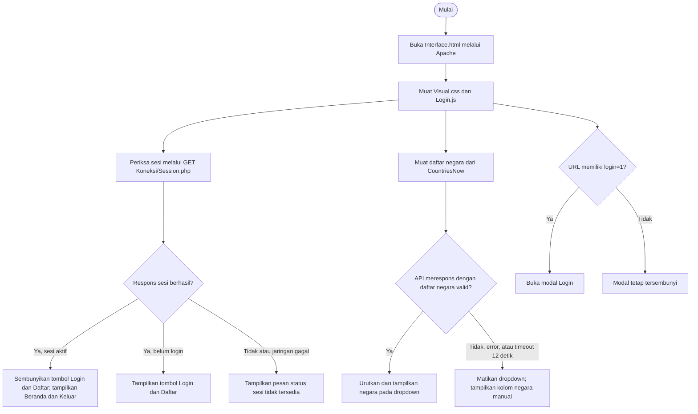
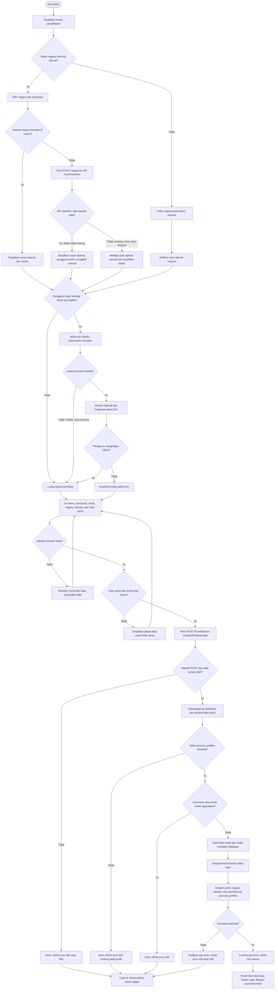
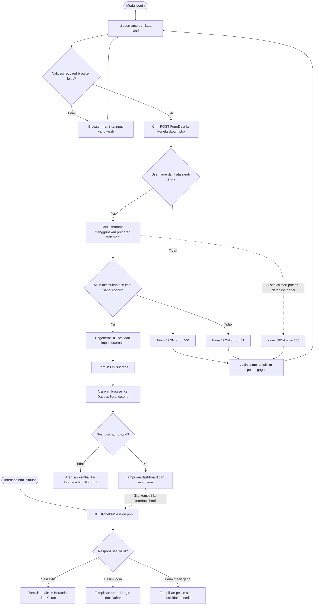
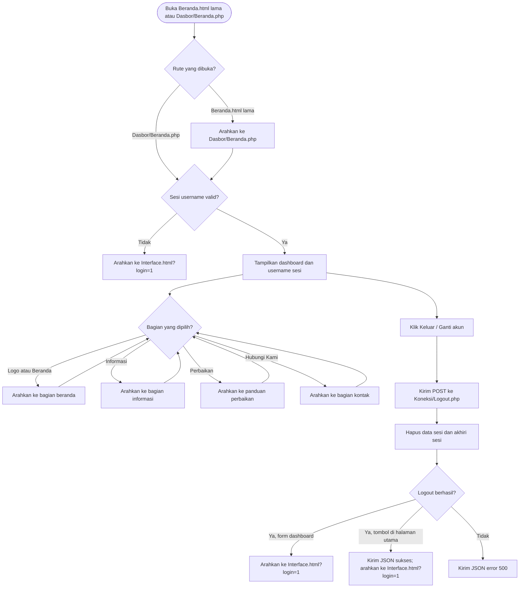
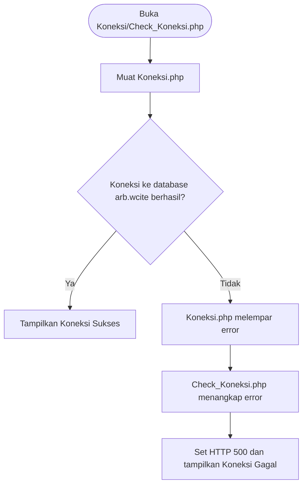

# Flowchart Program Arb.Wcite

Dokumen ini menggambarkan alur aplikasi berdasarkan implementasi saat ini:
`Interface.html`, `Login.js`, endpoint PHP di `Koneksi/`, dan `Dasbor/Beranda.php`.
Diagram menggunakan Mermaid dan dapat ditampilkan di VS Code atau GitHub.

## 1. Inisialisasi halaman dan data lokasi

Daftar negara dan daerah diambil langsung oleh browser dari API CountriesNow.
Jika daftar negara gagal dimuat, pendaftaran tetap dapat dilanjutkan dengan
mengisi negara dan daerah secara manual.

## 2. Pendaftaran akun dan pemilihan lokasi

Negara dan daerah wajib diisi; koordinat lokasi opsional. Jika daftar API gagal,
pengguna dapat memasukkan negara dan daerah sendiri. Setelah pendaftaran berhasil,
profil disimpan terpisah dari kredensial.

## 3. Login dan pemeriksaan sesi

Login menerima kata sandi hash melalui `password_verify`; kata sandi lama yang
belum di-hash masih diperiksa menggunakan pembandingan aman `hash_equals`.

## 4. Dashboard, navigasi, dan logout

Tautan dashboard berpindah ke bagian pada halaman yang sama. Proses perbaikan
yang tersedia saat ini berupa panduan informasi, bukan pengajuan perbaikan otomatis.

## 5. Pemeriksaan koneksi database

Pemeriksaan koneksi ini berdiri sendiri dan tidak dijalankan otomatis saat login.
