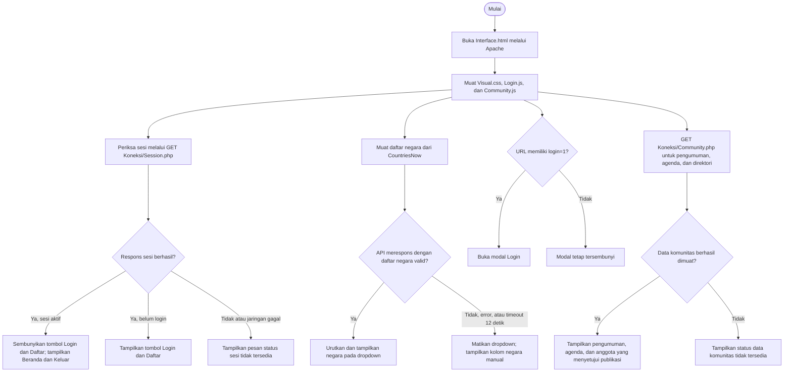
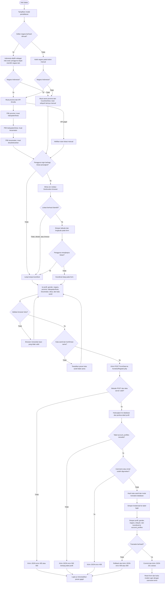
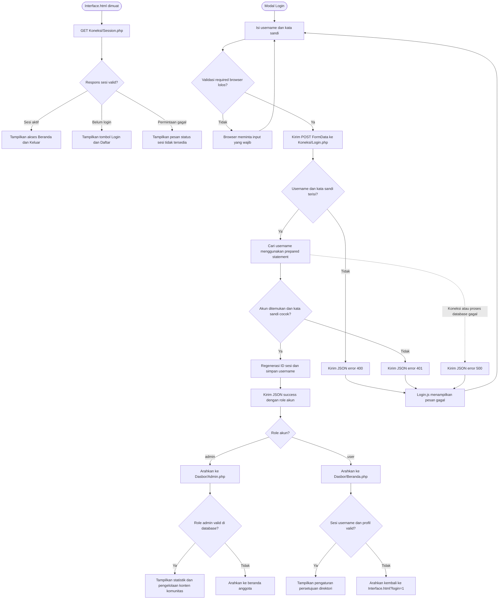
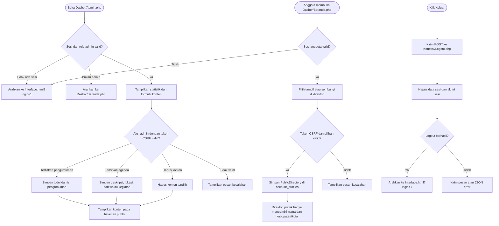

# Flowchart Program Arb.Wcite

Dokumen ini menggambarkan alur aplikasi berdasarkan implementasi saat ini:
`Interface.html`, `Login.js`, `Community.js`, endpoint PHP di `Koneksi/`, dan dashboard di `Dasbor/`.
Diagram menggunakan Mermaid dan dapat ditampilkan di VS Code atau GitHub.

## 1. Inisialisasi halaman dan data lokasi

Daftar negara diambil dari API CountriesNow dengan Indonesia sebagai pilihan
awal. Wilayah Indonesia dimuat dari API Emsifa; jika API negara gagal, negara
dapat diisi manual, dan jika API wilayah gagal, rincian wilayah dapat diisi
manual.
Data komunitas publik hanya mengirim nama dan kabupaten/kota anggota yang
secara eksplisit mengaktifkan direktori; email dan koordinat tidak disertakan.

## 2. Pendaftaran akun dan pemilihan lokasi

Jenis kelamin dan seluruh rincian wilayah wajib diisi; koordinat lokasi opsional.
Jika daftar API gagal, pengguna dapat memasukkan negara dan wilayah sendiri.
Setelah pendaftaran berhasil, profil disimpan terpisah dari kredensial.

## 3. Login dan pemeriksaan sesi

Login menerima kata sandi hash melalui `password_verify`; kata sandi lama yang
belum di-hash masih diperiksa menggunakan pembandingan aman `hash_equals`.

## 4. Konten komunitas, direktori, dan logout

Pengumuman dan agenda dapat dibaca publik. Aksi penerbitan dan penghapusan hanya
tersedia untuk admin yang telah diverifikasi di database dan mengirim token CSRF
yang valid. Anggota dapat mengubah persetujuan direktori kapan saja.

## 5. Pemeriksaan koneksi database

Pemeriksaan koneksi ini berdiri sendiri dan tidak dijalankan otomatis saat login.
